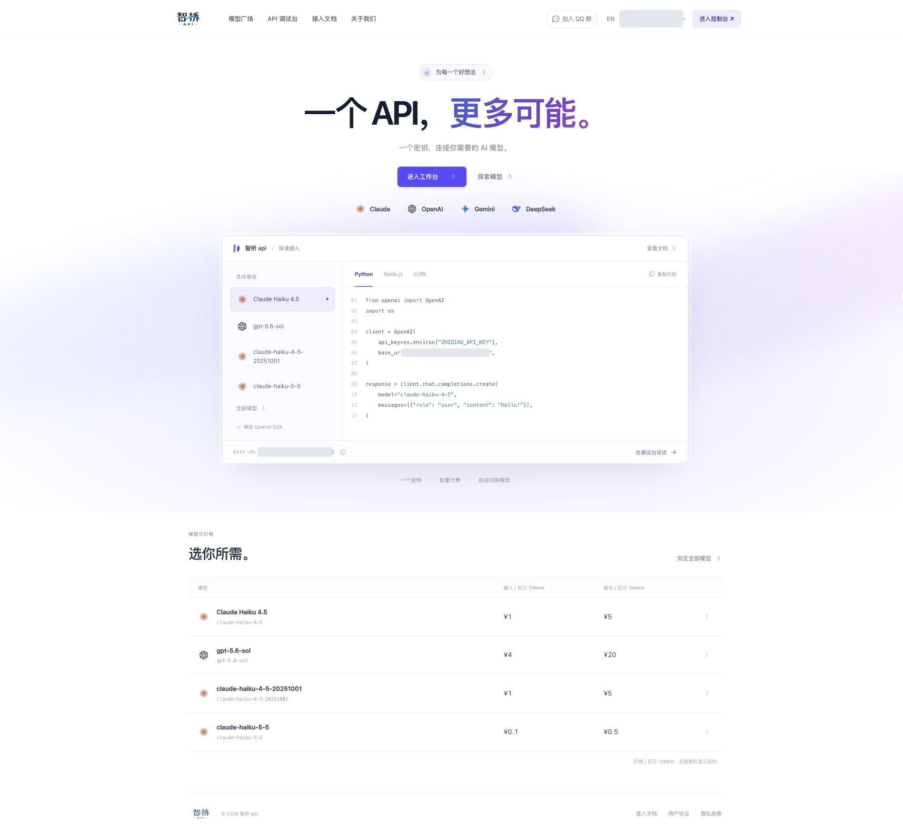
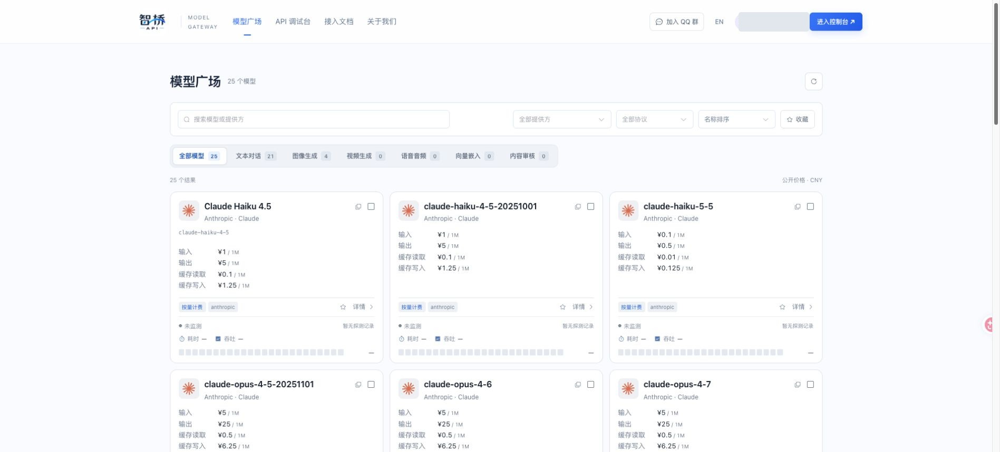
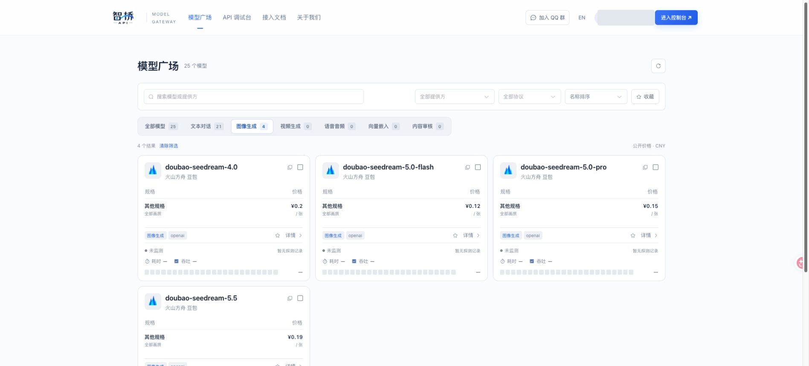
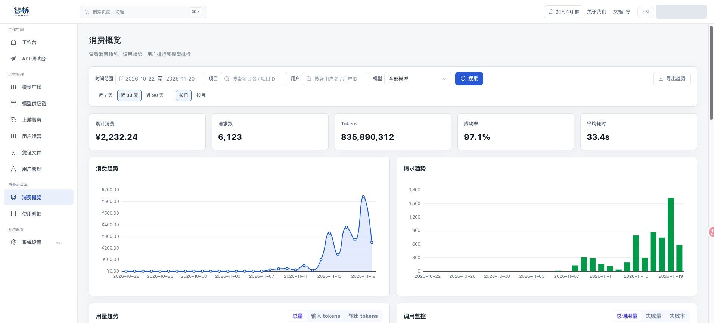
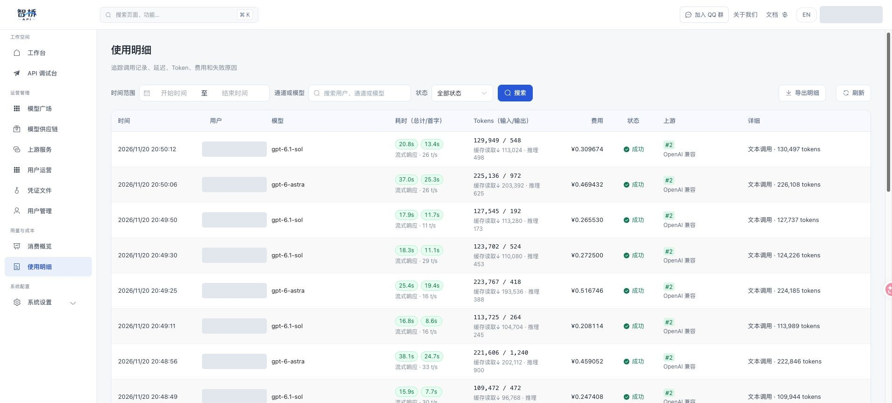
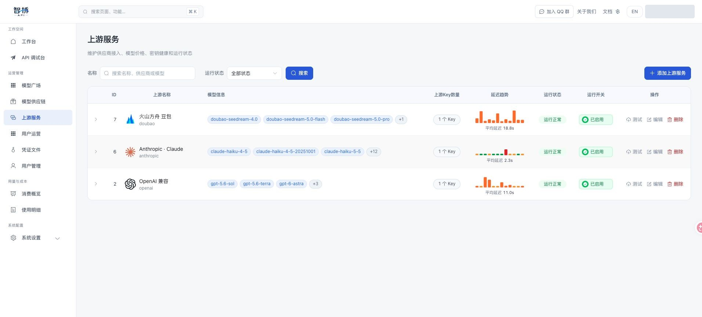
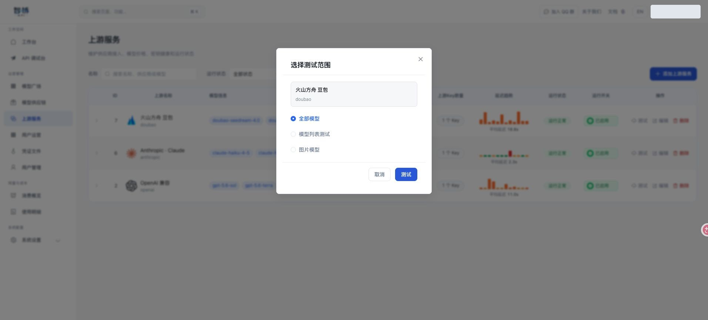
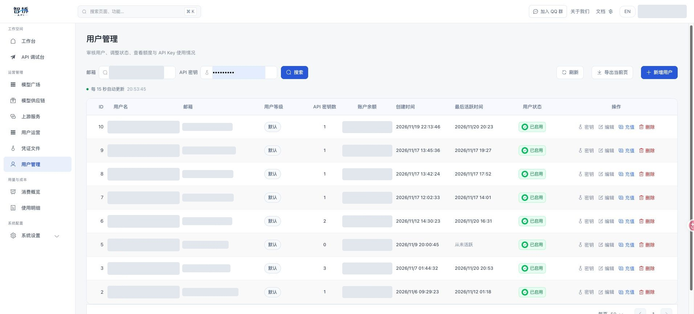
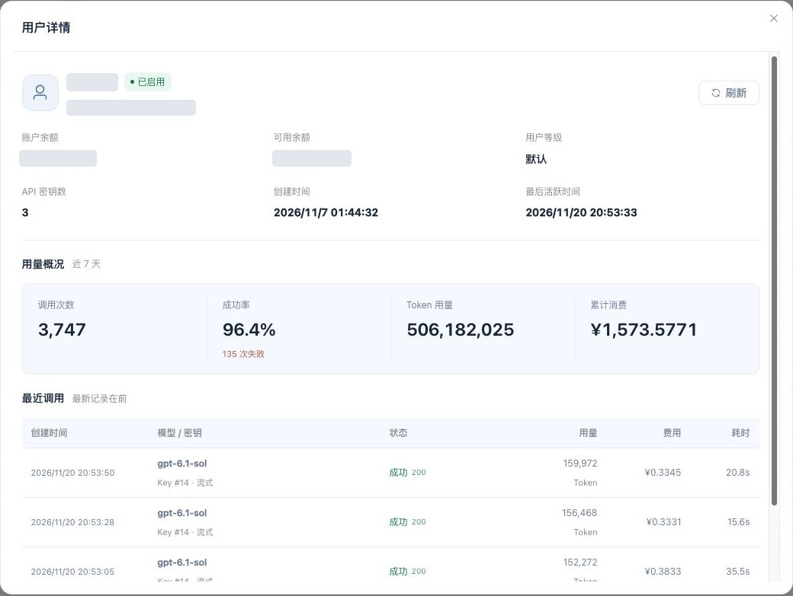

# 最新界面 · Screenshot gallery

截图日期：2026-11-20。以下图片均来自当前线上版本，账号身份等私密信息已遮挡，界面内容未作替换。

Captured from the live version on 2026-11-20. Private account information is redacted; the interface and displayed content are otherwise unchanged.

## 首页 · Homepage

统一入口、模型选择与 SDK 接入示例。

## 模型广场 · Model Plaza

模型筛选、提供商图标、输入输出及缓存价格。

## 图像模型报价 · Image pricing

图像模型按规格与计费单位展示价格；实际展示的档位取决于管理员已配置的报价。

## 消费概览 · Usage overview

消费、请求、Token、成功率及趋势图。

## 使用明细 · Request records

按请求查看模型、总耗时、首字耗时、缓存用量、费用和状态。

## 上游服务 · Upstream channels

提供商、已配置模型、Key 数量、已有延迟历史和运行开关。

## 测试范围 · Test scope

手动测试前可选择模型范围。本次截图仅打开范围选择界面，未执行模型测试。

## 用户管理 · User management

用户列表支持每 15 秒自动更新；点击行内空白区域或用户名可查看详情。

## 用户详情 · User details

查看用户状态、账户信息、近七天用量和最近调用；记录支持继续加载。

